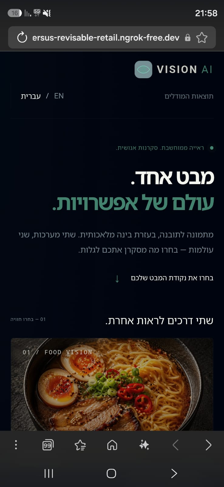
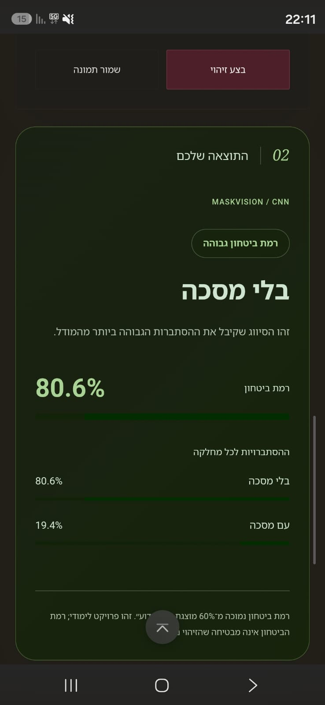
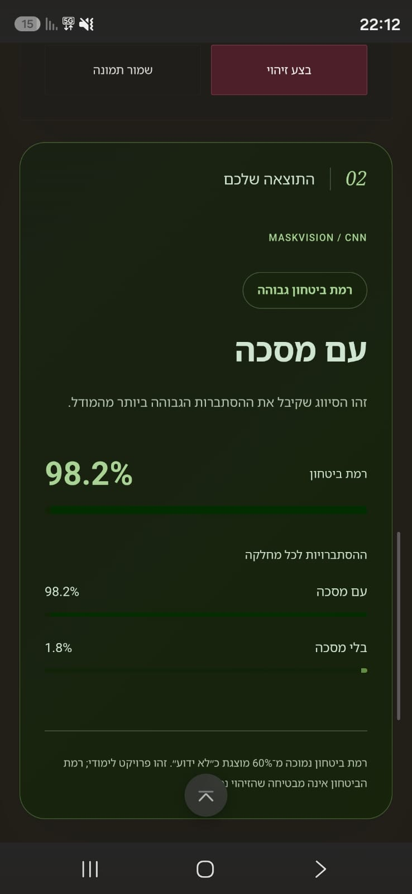
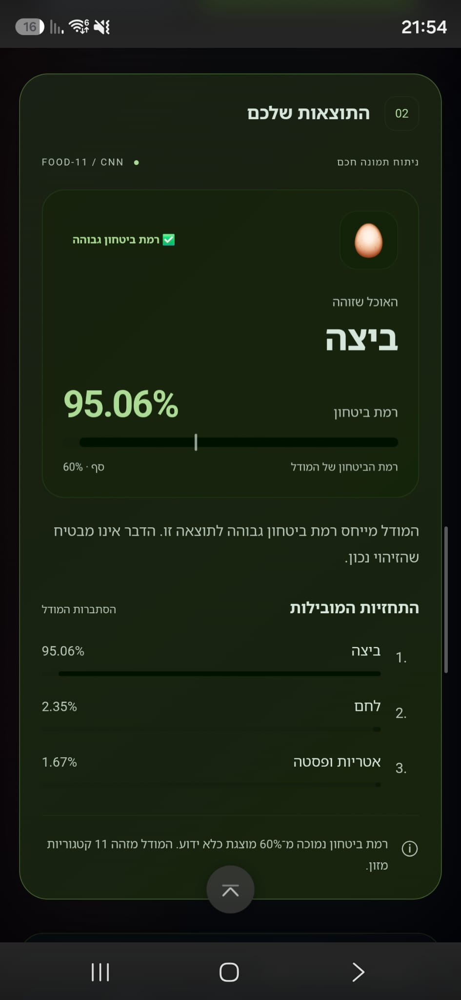

# 👁️ Vision AI

מערכת לזיהוי מזון ומסכות בתמונות באמצעות רשתות נוירונים מסוג **CNN**. הפרויקט מחבר בין אימון מודלים ב־Google Colab לבין אתר שבו ניתן להעלות תמונה ולקבל תחזית מהמודלים השמורים. מסמך זה מרכז את התיעוד של כל חלקי הפרויקט.

## 🎯 יכולות המערכת

| רכיב | תפקיד |
|---|---|
| **FoodVision AI** | סיווג תמונה לאחת מ־11 קטגוריות מזון. |
| **MaskVision AI** | סיווג לתמונה עם מסכה או בלי מסכה, לאחר בדיקה שמופיעות פנים של אדם אחד. |
| **VisionAI Hub** | דף כניסה משותף ועמוד תוצאות האימון וההערכה. |

הממשק תומך בעברית ובאנגלית, במחשב ובטלפון ובמצב בהיר או כהה בממשקי הזיהוי. דף הבית ועמוד התוצאות משתמשים בעיצוב כהה. אפשר להעלות תמונה, לצלם בטלפונים תומכים, לנסות תמונות לדוגמה ולהוריד את התמונה שנבחרה. התוצאה כוללת מחלקה חזויה, ציון ביטחון והסתברויות למחלקות. תמונות הדוגמה מפעילות חיזוי אמיתי בכל לחיצה.

## 🛠️ במה השתמשנו ולמה?

| טכנולוגיה | השימוש בפרויקט |
|---|---|
| **Python 3.12** | מימוש השרת, עיבוד התמונות וכלי עיבוד התוצאות. |
| **TensorFlow ו־Keras** | בנייה ואימון של רשתות CNN, שמירת המודלים וטעינתם לחיזוי. |
| **FastAPI** | קבלת תמונות דרך API, הפעלת החיזוי והגשת עמודי האתר. |
| **Uvicorn** | הפעלת אפליקציית FastAPI כשרת אינטרנט. |
| **OpenCV ו־YuNet** | זיהוי וספירת פנים לפני סיווג מסכות. |
| **Pillow ו־NumPy** | קריאת תמונות, תיקון כיוון לפי EXIF ועבודה עם מערכי פיקסלים. |
| **HTML, CSS ו־JavaScript** | מבנה ועיצוב הממשק, תמיכה בשפות ובמובייל, העלאת תמונות והצגת תוצאות. |
| **Google Colab ומחברות Jupyter** | סביבת אימון ותיעוד הניסויים. |
| **pandas, Matplotlib ו־scikit-learn** | עיבוד תוצאות, גרפים, דוחות סיווג ומטריצות בלבול במחברות. |
| **unittest** | בדיקות עיבוד התמונות, תנאי הסיווג והתנהגות השרת. |

קובץ `requirements.txt` שבשורש מכיל את תלויות **הפעלת האתר**. סביבת האימון מתועדת במחברות. האתר משתמש במודלים שמורים ואינו מאמן אותם בזמן ההפעלה.

## 🧠 המודלים ותהליך הלמידה

### FoodVision — זיהוי מזון

במחברת נבנו ואומנו מאפס שני מודלים: **Baseline CNN** ו־**Improved CNN**. שכבות הקונבולוציה לומדות מאפיינים חזותיים מהתמונות. המודל המשופר כולל שכבות נוספות, Data Augmentation להרחבת מגוון דוגמאות האימון, Batch Normalization לייצוב הלמידה ו־Dropout לצמצום התאמת יתר.

המשקלים מתעדכנים באמצעות Adam. נעשה שימוש ב־Early Stopping לעצירת אימון שאינו משתפר, ב־Model Checkpoint לשמירת מודל וב־ReduceLROnPlateau להקטנת קצב הלמידה. בחירת המודל התבססה על Validation; המודל הנבחר הוערך בנפרד על Evaluation.

השרת טוען את `FoodVision-AI/model/foodvision.keras` ומאמת את סדר המחלקות ואת הגדרות העיבוד לפני השימוש.

### MaskVision — זיהוי מסכות

מחברת [אימון MaskVision](MaskVision-AI/training/MaskVision_AI_2_Classes.ipynb) כוללת 15 תאי עבודה ותא סיכום של מחזור האימון הנבחר. המחברת מאמנת מודל עם שתי מחלקות: `with_mask` ו־`without_mask`. תמונות `incorrect_mask` אינן נכללות באימון, באימות או בהערכה. נעשה שימוש רק ב־`with_mask` וב־`without_mask`. תיקיית העבודה ב־Drive היא `MaskVision-AI-3`, והמאגר נקרא `FaceMask-3.zip`. המודל נשמר בשם `maskvision_baseline.keras` והיסטוריית האימון בשם `maskvision_baseline_history.csv`.

מודל CNN בעל שלוש שכבות קונבולוציה עם 32, 64 ו־128 מסננים ו־Dropout, שאומן עם Adam. במחברת נעשה שימוש ב־Early Stopping וב־Model Checkpoint. סדר מחלקות הפלט במודל הפעיל:

1. `with_mask` — עם מסכה.
2. `without_mask` — בלי מסכה.

לפני הסיווג, YuNet בודק את התמונה המלאה. ללא פנים או עם יותר מפנים של אדם אחד, המערכת מבקשת תמונה מתאימה. אם הגלאי אינו זמין, הסיווג נחסם. סף הביטחון של הגלאי הוא 0.8; התמונה מותאמת עם שמירת יחס ממדים וריפוד לגודל 640×640. הגלאי עלול להחמיץ פנים מכוסות או קטנות.

לאחר בדיקת הפנים, מודל המסכות מסווג את **התמונה המלאה**, בהתאם לתהליך האימון. התמונה אינה נחתכת לאזור הפנים. האימון כלל 25 epochs. המודל נבחר ב־Epoch 24 לפי הפסד האימות הנמוך ביותר (0.1052), עם דיוק אימות של 96.15%. בהערכה על קבוצת הבדיקה התקבלו 95.46% דיוק והפסד של 0.1239.

תא 14 במחברת מדגים חיזוי על שתי תמונות שנבחרות אוטומטית מקבוצת ההערכה: אחת עם מסכה ואחת ללא מסכה. הוא מציג תווית צפויה לצד התחזית וההסתברויות. גלאי YuNet פועל בשרת האתר ואינו מופעל בתא זה; תוצאות התא הן של מסווג ה־CNN בלבד.

### עיבוד התמונה ומשמעות הביטחון

התמונות מומרות ל־RGB, מותאמות לגודל **128×128** באינטרפולציה בילינארית של TensorFlow ומנורמלות בחלוקה ב־255. כיוון תמונות טלפון מתוקן לפי EXIF כשנדרש. קובצי `preprocessing.json` מתעדים את ההגדרות לשמירת התאמה בין האימון לחיזוי.

כאשר ציון הביטחון המרבי נמוך מ־**60%**, התוצאה מוצגת כ־**Unknown**. ציון Softmax גבוה אינו מבטיח תחזית נכונה; הסף אינו גלאי מכויל לתמונות מחוץ למחלקות האימון.

## 📊 תוצאות מתועדות

| מודל | דיוק Evaluation | מספר תמונות |
|---|---:|---:|
| FoodVision — Improved CNN | 72.06% | 3,347 |
| MaskVision — Baseline CNN | 95.46% | 1,432 |

אלו תוצאות מהניסויים השמורים, ולא הערכה חדשה בזמן הפעלת האתר. תוצאות FoodVision מגיעות מקובצי הייצוא; תוצאות MaskVision מגיעות מקובצי הייצוא של האימון החדש וממחברת האימון עם הפלטים. מדדי MaskVision אינם כוללים הערכה של גלאי הפנים. המדדים חושבו לפני החלת כלל Unknown באתר.

עמוד התוצאות מציג היסטוריות אימון, דוחות לכל מחלקה, מטריצות בלבול וקבצים להורדה. הדיוק המתועד אינו מבטיח דיוק זהה בצילום חדש מטלפון. מומלץ לצלם פריט מזון או אדם אחד בתאורה טובה.

### נתוני אימון MaskVision

| קבוצה | עם מסכה | בלי מסכה | סך הכול |
|---|---:|---:|---:|
| אימון | 3,352 | 3,322 | 6,674 |
| אימות | 718 | 712 | 1,430 |
| הערכה | 719 | 713 | 1,432 |
| סך הכול | 4,789 | 4,747 | 9,536 |

במטריצת הבלבול: 682 תמונות עם מסכה ו־685 ללא מסכה סווגו נכון; 37 תמונות עם מסכה סווגו כ״בלי מסכה״ ו־28 ללא מסכה סווגו כ״עם מסכה״. החלוקה נעשתה אקראית לפי קבצים, ללא בדיקת כפילויות או זהויות בין הקבוצות. שתי דוגמאות החיזוי במחברת אינן מדד נוסף לדיוק, ויש לבדוק בנפרד תמונות טלפון, ובפרט אנשים עם זקן.

## 📁 מבנה הפרויקט

```text
Project-Vision AI/
├── FoodVision-AI/
│   ├── frontend/                         # ממשק המזון ותמונות הדוגמה
│   ├── model/                            # מודל מזון, מחלקות והגדרות עיבוד
│   ├── training/foodvision_training.ipynb
│   ├── results/                          # מדדי מקור והיסטוריות אימון
│   └── tests/test_preprocessing.py
├── MaskVision-AI/
│   ├── frontend/                         # ממשק מסכות ודוגמאות בדיקת פנים
│   ├── model/                            # מודל שתי מחלקות, YuNet ורישיונו
│   ├── training/MaskVision_AI_2_Classes.ipynb
│   ├── results/                          # ייצוא האימון, חלוקת נתונים וגרפים
│   └── tests/test_api.py
├── VisionAI-Hub/
│   ├── backend/main.py                   # השרת המשותף
│   ├── frontend/
│   │   ├── index.html                    # דף הבית וגלריית ההדגמות
│   │   ├── script.js                     # שפות ופתיחת צילומי ההדגמה
│   │   ├── style.css
│   │   ├── config.js                     # קישורי חלקי האתר
│   │   ├── results.html
│   │   ├── results.js
│   │   ├── results.css
│   │   ├── results-data.json             # נתונים לגרפים ולטבלאות
│   │   ├── results-files/                # עותקי תוצאות להצגה ולהורדה
│   │   └── assets/
│   │       └── mobile-demo/              # צילומי הטלפון ונתוני הגלריה
│   └── build_results.py                  # אימות התוצאות ועדכון נתוני האתר
├── project03_cnn_dec25.pdf
├── requirements.txt                      # תלויות ריצה משותפות
├── .python-version
├── .gitignore
└── README.md
```

העץ מציג את קובצי המקור והמסירה המרכזיים. שם תיקיית השורש הוא `CNN_Project` בעותק VS Code ו־`Project-Vision AI` בעותק PyCharm; המבנה הפנימי זהה. סביבות Python, מטמון ותיקיית `tmp/` המקומית אינן חלק מהמסירה ומוחרגות ב־`.gitignore`. קיים קובץ תלויות אחד ו־README ראשי אחד לפרויקט.

שלוש התיקיות הראשיות צריכות להישאר זו לצד זו. שרת אחד מפעיל את כל חלקי האתר. מאגרי תמונות האימון אינם כלולים בפרויקט. קישורי העמודים מוגדרים ב־`VisionAI-Hub/frontend/config.js`.

## 🚀 התקנה והפעלה מקומית

פתחו טרמינל **בתיקיית הפרויקט**, שבה נמצא `requirements.txt`. בהתקנה חדשה ב־Windows, עם Python 3.12 מותקן:

```powershell
py -3.12 -m venv .venv
.\.venv\Scripts\python.exe -m pip install -r requirements.txt
.\.venv\Scripts\python.exe -m uvicorn main:app --app-dir VisionAI-Hub/backend --host 0.0.0.0 --port 8000
```

אם כבר קיימת סביבת Python 3.12 עם התלויות, בחרו או הפעילו אותה והריצו מתיקיית הפרויקט:

```powershell
python -m uvicorn main:app --app-dir VisionAI-Hub/backend --host 0.0.0.0 --port 8000
```

המתינו להודעה `Application startup complete`. השאירו את הטרמינל פתוח בזמן השימוש; לעצירה לחצו `Ctrl+C`.

| עמוד | כתובת |
|---|---|
| 🏠 דף הבית | http://localhost:8000/home |
| 🍽️ זיהוי מזון | http://localhost:8000/ |
| 😷 זיהוי מסכות | http://localhost:8000/mask |
| 📈 תוצאות המודלים | http://localhost:8000/results |
| ✅ מוכנות המודלים וגלאי הפנים | http://localhost:8000/ready |

### הגדרת הרצה ב־PyCharm

צרו Python Run Configuration המפעילה Module name:

| שדה | ערך |
|---|---|
| Module name | `uvicorn` |
| Parameters | `main:app --app-dir VisionAI-Hub/backend --host 0.0.0.0 --port 8000` |
| Working directory | הנתיב המלא לתיקיית `Project-Vision AI` |
| Python Interpreter | סביבת Python 3.12 שבה הותקנו התלויות |

אפשר לשמור את הפרויקט לצד פרויקטים אחרים בתיקיית קורס. תיקיית העבודה של ההרצה צריכה להיות תיקיית הפרויקט עצמו. `.python-version` מתעד את הגרסה ואינו מחליף את בחירת ה־Interpreter ב־PyCharm. אין להכניס נתיב Interpreter בשדה Paths to .env files.

### פתרון תקלות נפוצות

- **`main:app is not recognized`** — בטרמינל יש להריץ את הפקודה המלאה עם `python -m uvicorn`, ולא את Parameters לבדו.
- **`Could not import module "main"`** — ודאו שאתם בתיקיית הפרויקט ושקיים `VisionAI-Hub/backend/main.py`. אם התקלה נמשכת, בדקו את השגיאה המלאה.
- **`No module named ...`** — התקינו את התלויות באמצעות אותו Interpreter שמפעיל את השרת.
- **פורט 8000 תפוס** — עצרו את ההרצה הקודמת.
- **האתר עולה אך החיזוי אינו זמין** — בדקו את `/ready` ואת לוג טעינת המודלים. עליית השרת לבדה אינה מבטיחה ששני המודלים נטענו.

## 🧪 בדיקות ותחזוקת התוצאות

מהסביבה עם תלויות הפרויקט, ומתוך תיקיית הפרויקט:

```powershell
python -m unittest discover -s FoodVision-AI/tests -v
python -m unittest discover -s MaskVision-AI/tests -v
```

הבדיקות מכסות עיבוד תמונות, סדר מחלקות, כלל 60%, סיבוב EXIF, קלט לא תקין ותנאי גלאי הפנים. הן אינן מחליפות הערכת דיוק על מאגר עצמאי.

לאחר החלפת קובצי ניסוי, בנו מחדש את נתוני עמוד התוצאות:

```powershell
python VisionAI-Hub/build_results.py
```

הסקריפט מאמת מדדים והיסטוריות, קורא את קובצי התוצאות המיוצאים של MaskVision, מעדכן `results-data.json` ומעתיק קבצים ל־`results-files`. הוא אינו מאמן מודלים ואינו מריץ מחברות. העותקים שבתיקיית האתר נדרשים להצגה ולהורדה. אלה כפילויות מכוונות: המקור נשמר בתיקיות התוצאות, והסקריפט מסנכרן את עותקי הפרסום. תמונת הראמן ומסמך המטלה מוגשים ישירות מקובצי המקור, ללא עותק נוסף.

מחברות האימון: [FoodVision](FoodVision-AI/training/foodvision_training.ipynb) · [MaskVision](MaskVision-AI/training/MaskVision_AI_2_Classes.ipynb).

## 📱 הדגמה מהטלפון

לאחר התקנת ngrok והגדרת החשבון, פתחו מנהרה לשרת המקומי בטרמינל נוסף:

```powershell
ngrok http 8000
```

פתחו בטלפון את כתובת ה־HTTPS שמתקבלת והוסיפו `/home`. המחשב, השרת ו־ngrok צריכים להישאר פעילים ומחוברים לאינטרנט. **כתובת אירוח קבועה והסבר על הפריסה יתווספו לאחר שהפריסה תושלם ותיבדק.**

### צילומי הדגמה מהטלפון — 29.10.2026

שלוש דוגמאות חיזוי ותיעוד השימוש באתר בטלפון דרך ngrok. צילומי MaskVision משעה 22:11–22:12 מציגים קלט ותוצאות עם סמל 5G ללא סמל Wi‑Fi. דוגמת המזון תועדה בחיבור Wi‑Fi. שורת הכתובת של ngrok מתועדת בצילום דף הבית; היא אינה מופיעה בצילומי המסכות החדשים. כתובת ההדגמה: `https://versus-revisable-retail.ngrok-free.dev/home`; זמינותה תלויה במחשב, בשרת ובמנהרה פעילים. זו אינה כתובת אירוח קבועה.

| הדגמה | קלט / מסך | תוצאה |
|---|---|---|
| גישה מהטלפון דרך ngrok | [דף הבית וכתובת ngrok](VisionAI-Hub/frontend/assets/mobile-demo/home-cellular.jpg) | [הסבר הפרויקט בטלפון](VisionAI-Hub/frontend/assets/mobile-demo/home-about.jpg) |
| ללא מסכה — צילום מעודכן עם 5G | [תמונת הקלט בממשק](VisionAI-Hub/frontend/assets/mobile-demo/mask-without-input.jpg) | [בלי מסכה — 80.6%](VisionAI-Hub/frontend/assets/mobile-demo/mask-without-result.jpg) |
| איפור פנים — מקרה כשל, צילום מעודכן עם 5G | [תמונה עם איפור וללא מסכה](VisionAI-Hub/frontend/assets/mobile-demo/facepaint-input.jpg) | [תחזית שגויה: עם מסכה — 98.2%](VisionAI-Hub/frontend/assets/mobile-demo/facepaint-result.jpg) |
| זיהוי ביצה | [תמונת המקור](VisionAI-Hub/frontend/assets/mobile-demo/food-source.jpg) · [העלאה בטלפון](VisionAI-Hub/frontend/assets/mobile-demo/food-input.jpg) | [ביצה — 95.06%](VisionAI-Hub/frontend/assets/mobile-demo/food-result.jpg) |

<p>
<a href="VisionAI-Hub/frontend/assets/mobile-demo/home-cellular.jpg"></a>
<a href="VisionAI-Hub/frontend/assets/mobile-demo/mask-without-result.jpg"></a>
<a href="VisionAI-Hub/frontend/assets/mobile-demo/facepaint-result.jpg"></a>
<a href="VisionAI-Hub/frontend/assets/mobile-demo/food-result.jpg"></a>
</p>

לחיצה על תמונה פותחת את הצילום המלא. התמונות נשמרו ללא חיתוך או שינוי כדי לשמר את כתובת האתר, הנתונים המוצגים והקשר השימוש. [צילום ממשק מוקדם](VisionAI-Hub/frontend/assets/mobile-demo/home-projects-historical.jpg) נשמר כתיעוד היסטורי בלבד: מופיע בו תיאור ישן של שלוש מחלקות, שאינו תואם למודל הפעיל בעל שתי המחלקות.

**הדוגמאות מתעדות שימוש ואינן מדד לדיוק הכולל.** מקרה איפור הפנים מדגים שגם חיזוי בביטחון גבוה עלול להיות שגוי. הגלריה באתר מציגה את צילומי ההרצה הקיימים; לחיצה עליהם אינה מפעילה חיזוי חדש.

## 🎨 תמונות, מקורות ורישיונות

- **תמונות הראמן:** נוצרו לפרויקט באמצעות `imagegen`. גרסת המחשב `ramen-hero.jpg` בגודל 1122×1402, וגרסת הטלפון `ramen-hero-mobile.jpg` בגודל 640×800. שתיהן JPEG באיכות 86; גרסת הטלפון נבחרת במסכים ברוחב עד 760 פיקסלים. אלו נכסי עיצוב, ולא פלט של מודל הסיווג.
- **`example-fruit.jpg`:** תמונת פירות מ־[Unsplash](https://images.unsplash.com/photo-1619566636858-adf3ef46400b), לפי [רישיון Unsplash](https://unsplash.com/license).
- **`example-mask.jpg`:** דוגמה עם מסכה שהוחלה דיגיטלית, מתוך [prajnasb/observations](https://github.com/prajnasb/observations/blob/master/experiements/data/with_mask/100-with-mask.jpg). בכל לחיצה מתבצע חיזוי מחדש.
- **`example-multiple-faces.png`:** תמונת דוגמה של שלושה אנשים בדיוניים שנוצרה באמצעות `imagegen`. לחיצה עליה מפעילה את גלאי הפנים האמיתי ומדגימה את הודעת ריבוי הפנים; זו אינה תוצאת סיווג מסכה.
- **YuNet:** מתוך [OpenCV Zoo](https://github.com/opencv/opencv_zoo/tree/main/models/face_detection_yunet). הרישיון נשמר ב־[YUNET-LICENSE.txt](MaskVision-AI/model/YUNET-LICENSE.txt).

<details>
<summary>הנחיית היצירה המקורית של תמונת הראמן</summary>

Use case: photorealistic-natural. Asset type: website hero food photography, portrait 4:5 composition. Create an ultra realistic premium editorial photograph of one beautifully plated bowl of Japanese ramen, glossy rich amber broth, sculptural golden noodles, two soft-boiled egg halves with rich orange yolks, red chili slices, toasted sesame, a little scallion, and delicate steam. Matte black ceramic bowl on deep charcoal stone backdrop. Three-quarter overhead camera, entire bowl visible centered with generous negative space around edges for web cropping. Dramatic warm side lighting, soft amber rim light and deep elegant shadows, extremely appetizing, fine natural food texture, high-end restaurant campaign aesthetic, controlled restrained palette of charcoal black, golden amber, burnt orange and red. Real food photography, not illustration or 3D. No text, no graphic overlays, no watermarks, no branding, no humans, no props obscuring the food. Intended for a cinematic FoodVision AI website with charcoal UI.

</details>

## 📦 מסירה וניהול קבצים

כללו את הקוד, המודלים, הגדרות העיבוד, מחברות האימון, התוצאות, נכסי האתר ומסמך המטלה. במאגר נפרד לפרויקט, שורש המאגר צריך להכיל את שלוש תיקיות הפרויקט וקובצי השורש.

אין להעלות סביבות Python כגון `.venv` ו־`.venv-model`, תיקיות `.idea`, מטמון `__pycache__`, קובצי `.env`, טוקנים או ארכיוני מאגרי תמונות. `.gitignore` מסייע להחריג אותם. יש לשמור את רישיון YuNet לצד הגלאי.
